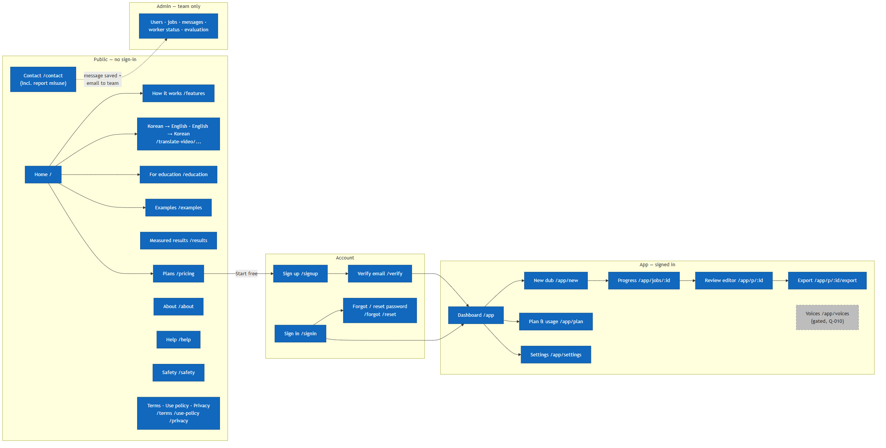
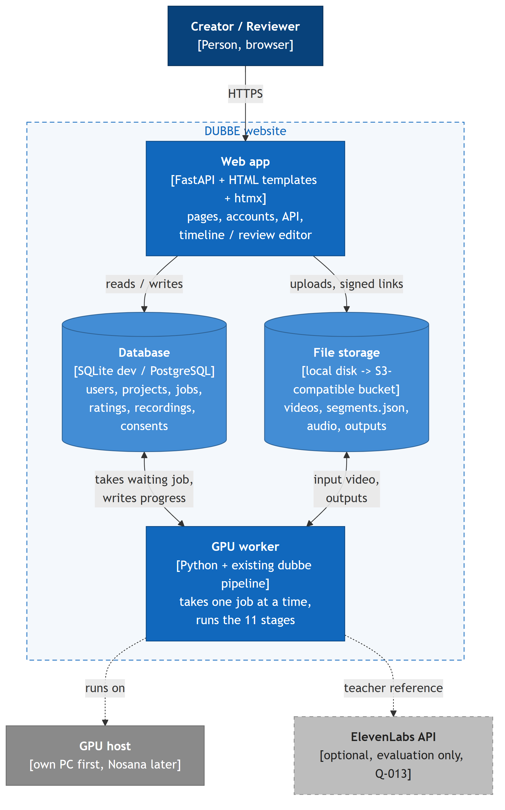

# DUBBE — Website Plan (draft v2, 2026-10-15)

The full website: a **public site** (home, how it works, language-pair pages, education, examples, measured results, plans, about, contact, help, safety, legal), **accounts** (sign up, sign in, email check, password reset), the **app** (upload, progress, review editor, export, plan & usage, settings) and an **admin** area. The app runs the existing pipeline (`src/dubbe/`, 11 stages, 42 unit tests); nothing in the pipeline is rewritten.

## Build status (2026-10-15)

**Built and running locally (`dubbe-web`, `src/dubbe/web/`):** every public page in section 1 except the press kit; sign up, email check, sign in/out, forgot/reset password, settings, delete account; Free-plan limits (minutes, length) and automatic deletion after the plan's retention; upload → job queue → worker running the normal `dubbe` command → progress page → review editor (timeline, edit text, tags, voice, blind rating, re-dub) → downloads (MP4 with AI label in its metadata, SRT/VTT in both languages, report); contact form and paid-plan waitlist (stored, emailed when SMTP is set); admin (worker, jobs + retry, messages, users, evaluation).
**Checked:** 8 automated website tests (pages, account flow, one user cannot open another's project, cross-site posts refused, contact limit, upload queues a job, subtitles); one real end-to-end run — FLEURS upload dubbed in 72 s, text edit + tag + voice change + re-dub in 33 s, all downloads; no horizontal scrolling at 390 px on the public pages.
**Added 2026-10-15 (after ElevenLabs' app):** sidebar app with a home dashboard; single tools next to dubbing — Text to Speech with inline tags, Speech to Text with subtitles, Translate with confidence, Voice Isolator — each a queued GPU task reusing the pipeline stages (`web/tools.py`, table `tasks`); History and Voice library; admin dashboard with key numbers, a 14-day chart and user management. Measured first runs: TTS 16 s, Translate 14 s, Speech to Text (2.7 min clip, with translation) 26 s, Voice Isolator 14 s.
**Not built yet:** Korean site language; school-email bonus minutes (decision 8); recording your own lines (C15); payments (waitlist only); cloud GPU worker and deployment (phase 6); press kit; outside-user test (phase 7).
**Found while building:** the translation model (NLLB-200) and the Korean voice (MMS-TTS) are CC BY-NC 4.0 — the site states that DUBBE is non-commercial during the beta, and paid plans need other models first. **2026-10-15:** the Korean voice is now Chatterbox Multilingual (MIT); only the translation model is still non-commercial.

## 0. Starting point

| Exists and tested | Missing |
|---|---|
| 11-stage pipeline (`dubbe` command), resumable, files per stage | Every public page, accounts, plans and limits, contact, legal texts |
| Local test page (Gradio): Dub tab; Review tab with coloured timeline, rating, tags, text correction, re-dub | Job queue — today one dub blocks the page until it finishes |
| Report, stats and cost per run; error-propagation and rating scripts | Database, file storage off the laptop, email sending |
| Background sound, voice matching, picture slow-down, vocal tags (Chatterbox, English) | Cloud GPU worker, subtitle export, deployment (domain, HTTPS) |

## 1. Site map

| Area | Page | URL | Phase |
|---|---|---|---|
| Public | Home | `/` | 4 |
| | How it works (incl. languages: tested vs. designed for) | `/features` | 4 |
| | Korean → English, English → Korean (one page per tested pair) | `/translate-video/korean-to-english` `/translate-video/english-to-korean` | 4 |
| | For lecturers and schools (+ school-email offer) | `/education` | 4 (offer in 5) |
| | Examples | `/examples` | 4 |
| | Measured results | `/results` | 4 |
| | Plans (+ plan FAQ) | `/pricing` | 4 |
| | About | `/about` | 4 |
| | Contact (incl. "report misuse") | `/contact` | 4 |
| | Help (FAQ in categories) | `/help` | 4 |
| | Safety (incl. AI notice) | `/safety` | 4 |
| | Terms · Use policy · Privacy | `/terms` `/use-policy` `/privacy` | 4 |
| | Press kit (optional) | `/brand` | 7 |
| Account | Sign up · Sign in · Sign out | `/signup` `/signin` `/signout` | 3 |
| | Verify email | `/verify?token=…` | 3 |
| | Forgot / reset password | `/forgot` `/reset?token=…` | 3 |
| App | Dashboard (projects + minutes left) | `/app` | 1 → 3 |
| | New dub | `/app/new` | 1 |
| | Progress | `/app/jobs/{id}` | 1 |
| | Review editor | `/app/p/{id}` | 2 |
| | Export | `/app/p/{id}/export` | 2 |
| | Plan & usage | `/app/plan` | 5 |
| | Settings (profile, password, language, delete account) | `/app/settings` | 3 |
| | Voices (own-voice recording C15; cloning gated by Q-010) | `/app/voices` | 5 / gated |
| Admin | Users · jobs · messages · worker status · evaluation | `/admin/…` | 5 |

**Header (public):** logo · How it works · Examples · For education · Plans · Contact · language EN/KO · **Sign in** · **Start free**.
**Header (signed in):** logo · Projects · New dub · minutes left · language · account menu (Plan & usage, Settings, Sign out).
**Footer (every page), grouped like ElevenLabs':** *Product* — How it works, Korean → English, English → Korean, For education, Examples, Plans · *Resources* — Help, Measured results, GitHub · *Company* — About, Safety, Contact, Report misuse · *Legal* — Terms, Use policy, Privacy · plus "Inha University × HumbleBeeAI capstone, Fall 2026" and "Dubs on this site are AI-generated".

## 2. Public pages — what is on each

**Home `/`**
1. Headline + one line: *"Dub your lecture into another language — and see exactly which sentences to check."* Buttons: **Start free**, **See an example**.
2. Demo player: a licensed example (FLEURS, CC BY 4.0) with original/dubbed switch and the coloured timeline of flagged sentences — the feature no competitor we checked has ([competitors.md](competitors.md)).
3. How it works in 3 steps: upload → DUBBE dubs and marks doubtful sentences → you fix, re-dub, download.
4. What is different: review flags on the timeline · background sound kept · no timing drift · your corrections are never re-translated · a report with time and cost.
5. Honest comparison (short table from competitors.md), including what we do **not** do: voice cloning, lip sync, 90+ languages.
6. Measured results (3 numbers from `/results`) in place of customer logos — we have no customers yet.
7. "Safety, built in": rights check on upload · no voice cloning · every dub labelled AI-generated.
8. Plans teaser, three Help items, final **Start free**.

**How it works `/features`** — the pipeline in plain words with the architecture image; what each flag colour means; timing (speed-up ≤ 1.3×, shorter wording, picture slow-down); background sound; delivery tags; what the report shows; limits (2 languages tested, preset voices).

**Korean → English / English → Korean `/translate-video/…`** — one page per pair we have actually tested (ElevenLabs has 55 such pages from one template). 5 steps: upload → pick languages → DUBBE dubs and marks doubtful sentences → **fix the flagged sentences** (where ElevenLabs says "Machine generated or Human edited") → export. Then use cases (education first), the pair's measured results, FAQ, **Start free**. More pairs only after they are tested.

**For lecturers and schools `/education`** — lectures and course videos are our main use case (ElevenLabs lists "Education and training" first on its Korean page but has no dubbing page for it). Content: why flags matter for teaching material, subtitles in both languages, privacy of student-facing videos, school offer: **extra free minutes with a verified school email** (e.g. `*.ac.kr`, `*.edu`; amount decided with the plans), "School / Team" contact.

**Measured results `/results`** — our real numbers from [test-results.md](test-results.md): timing drift, recognition error (CER), translation score (chrF) with and without recognition errors, flag precision/recall once raters exist, run time and cost per minute; each with the date and the clip. Replaces customer stories, which we do not have.

**Examples `/examples`** — only clips we may publish: FLEURS (CC BY 4.0, with attribution) and team-recorded lectures with written consent. **Not** the Breaking Bad or TED-Ed clips (private tests only). Each example: player with original/dubbed switch, flags timeline, link to its report.

**Plans `/pricing`** — see section 4.

**About `/about`** — the problem, the team (names and roles as in the README), Inha × HumbleBeeAI, models and their licences, "AI tools (Claude) were used to write code and documentation; the team reviewed and tested it."

**Contact `/contact`**
- Form: name · email · topic (Support · Plans/business · School/education · Press · Privacy or data request · **Report misuse** (link to the dub) · Other) · message (≤ 2,000 characters) · checkbox "I have read the Privacy notice". `/contact?topic=report` pre-selects "Report misuse" (linked from Safety and the footer).
- Spam: hidden honeypot field + at most 3 messages per IP per hour; no CAPTCHA unless spam appears.
- On send: saved to the `messages` table (visible in Admin), email to the team address, short auto-reply to the sender ("received, we answer within 2 working days").
- Beside the form: team email, GitHub link, "student project — not a commercial service yet".

**Help `/help`** — FAQ in categories, like ElevenLabs' Help Center but on one page: *Account* · *Dubbing & review* · *Plans* · *Privacy & safety* · *Troubleshooting* (upload refused, job failed, voice sounds wrong, flags look wrong). Questions: Which languages? (ko ↔ en tested) · How long does it take? (measured: 18–21 s of processing per video minute on our GPU, plus waiting in the queue) · What do the colours mean? · Can I correct the dub? · Is my video private, who can see it, when is it deleted? · Can it use my own voice? (preset voices; recording your own lines is planned; cloning only if the course allows it) · Lip sync? (no) · File types and size? (MP4/MOV/WebM, ≤ 2 GB, plan limit on length) · How do I delete my data?

**Safety `/safety`** — set out like ElevenLabs' page (Prevent · Detect · Enforce · Inform), sized to us. *Prevent:* rights checkbox on upload, verified email before dubbing, preset voices only, no cloning. *Detect:* we review reported dubs (no automatic classifier). *Enforce:* we remove dubs and close accounts that break the Use policy. *Inform:* every dub labelled AI-generated (file metadata + export page; Chatterbox output also watermarked), how to report misuse. Includes the AI notice (Korea AI Basic Act, in force since 2026-01-22): how dubs are made and their known limits.

**Legal `/terms` `/use-policy` `/privacy`** — drafts written by the team and **checked with the instructor / university before going public** (we are not lawyers).
- *Terms:* upload only what you own or have a licence to change (No-Derivatives content not allowed); every dub is labelled AI-generated; prototype service "as is"; we can remove content that breaks the Use policy.
- *Use policy* (separate short page, as ElevenLabs does): no impersonation or deception, no dubbing other people's content without rights, no harassment, no political or election deception, no removing the AI label.
- *Privacy* (Korean PIPA): what we collect (email, password hash, videos, voice recordings, ratings), why, how long (original videos deleted after the plan's retention, account data until you delete the account), who processes it (GPU host, storage, email provider — named), your rights (see, download, delete), contact. Voice recordings may be biometric data → separate consent when recording is added.
- *Cookies:* only the sign-in session cookie; no tracking or advertising cookies. If analytics is ever added, this changes.

## 3. Accounts — sign up, sign in, password reset

| Flow | How |
|---|---|
| Sign up | email + password (min. 10 characters) + accept Terms/Privacy → account created, verification email sent |
| Verify email | link with a signed, single-use token, valid 24 h; until verified you can look around but not start a dub (stops throw-away accounts burning free GPU minutes) |
| Sign in | email + password; after 5 failed tries in 15 min for the same email/IP → wait 15 min |
| Session | random session id in a cookie: HttpOnly, Secure, SameSite=Lax; 14 days; stored hashed in `sessions`; sign out deletes it |
| Forgot password | always answers "if the address exists, we sent a link" (does not reveal who has an account); token hashed, single-use, 30 min; all sessions ended after a reset |
| Passwords | argon2id (`argon2-cffi`); never logged |
| Forms | CSRF token on every form (htmx sends it as a header) |
| Delete account | Settings → confirm with password → projects, files, recordings and sessions deleted; ratings kept only as anonymous numbers for the evaluation |
| Social sign-in (decision 2) | Google and/or Kakao (Kakao Login is common in Korea); later phase, same `users` table |
| Admin | `is_admin` flag set by hand in the database; admin pages check it on every request |

## 4. Plans (pricing page)

**What a minute costs us (measured, not guessed):** 18–21 s of GPU time per video minute → **≈ $0.002 per video minute** at the assumed $0.35/h cloud GPU (`stats.json`; price assumption in `languages.yaml`). With vocal tags (Chatterbox) the speech step is ~19× slower → ≈ $0.006/min. Not included: web server, storage, email, idle GPU time, payment fees, support — at small scale these are larger than the GPU cost.

**What others charge:** ElevenLabs ≈ $0.50–0.60/min automatic; Perso AI $0.55–1.00/min; Rask ≈ $2–3/min; YouTube auto-dub free but only for YouTube videos ([competitors.md](competitors.md)).

**Proposal (to test with real users before fixing prices):**

| | Free | Creator | Pro | School / Team |
|---|---|---|---|---|
| Price | $0 | $9 / month | $29 / month | contact us |
| Dubbed minutes per month | 15 | 120 | 600 | agreed |
| Longest video | 10 min | 60 min | 180 min | agreed |
| Review flags, editor, report, SRT/VTT | ✅ | ✅ | ✅ | ✅ |
| Keep background sound | ✅ | ✅ | ✅ | ✅ |
| Vocal tags ([laugh] …, English) | — | ✅ | ✅ | ✅ |
| Queue | normal | normal | first | agreed |
| Projects kept | 7 days | 30 days | 90 days | agreed |
| Price per minute at full use | — | $0.075 | $0.048 | — |

- Minutes count once per new video; re-dubs after corrections are free (encourages fixing flagged sentences).
- Limits are checked at upload: ffprobe length ≤ the plan's longest video, and minutes used this month + length ≤ plan minutes; otherwise a clear message with a link to Plans.
- **Payments are not built in this course.** Paid buttons say **"Join the waitlist"** and save the email + chosen plan (`messages`, topic "plan interest"). Sign-ups per plan are real evidence for the business slides. If payments come later: Korean payment providers (Toss Payments, PortOne); check whether Stripe accepts a Korea-based business before choosing it.
- Prices shown in USD and KRW; KRW amounts set when prices are decided.
- **The editor is on the Free plan.** ElevenLabs' Free plan has automatic dubbing but not Dubbing Studio (its editor); reviewing and fixing is our main feature, so it is never paywalled.
- **Plan FAQ** on the page (ElevenLabs has 11 questions; ours): What counts as a minute? · Do unused minutes carry over? (no) · Are re-dubs counted? (no) · What happens at the limit? · Where do I see minutes left? · How do I cancel or delete my data?
- If paid plans start: annual price = 10 × monthly (the same rule ElevenLabs uses).

## 5. App pages — what is on each

| Page | Contents |
|---|---|
| Dashboard | project cards: title, languages, status, length, flagged sentences, date; minutes left this month; **New dub** |
| New dub | upload (drag and drop), from/to language, keep background, allow picture slow-down, rights checkbox; shows length and minutes it will use before starting |
| Progress | stage-by-stage bar (11 stages), queue position, time so far; on failure: the error and **Retry from this stage**; optional email when done |
| Review editor | video + coloured timeline; sentence panel: original, dub text (editable), flags, tags, rating; record your own line (C15); voice choice; **Re-dub**; version history |
| Export | dubbed MP4 (labelled AI-dubbed), subtitles SRT/VTT in both languages, review report; time-limited download links |
| Plan & usage | current plan, minutes used per month, projects and when they expire, waitlist status |
| Settings | name, email, password, site language, delete account |
| Voices | own-voice recordings (C15, planned); **built 2026-10-15:** clone your own voice (C13, approved) and a voice Marketplace without payouts (C14: store front with search, categories, ratings and reviews; listing page; publish form) |

Desktop-first for the editor (needs ~1024 px wide; phones get "open on a computer to edit"); every public page and the dashboard work on phones.

## 6. Admin

`/admin/users` (plan, verified, minutes used, disable) · `/admin/jobs` (running/failed, error text, retry) · `/admin/messages` (contact and waitlist, mark handled) · `/admin/worker` (last heartbeat, current job, queue length) · `/admin/evaluation` (ratings, flag precision/recall, rater agreement, error-propagation runs).

## 7. Architecture

| Part | Choice | Why |
|---|---|---|
| Web app | **FastAPI** (course template *rest-fastapi-orm-template*) serving HTML with Jinja templates; **htmx** for live progress, forms and the editor; the existing timeline JavaScript | One language (Python); no separate frontend build. Alternative: React/Next.js (decision 1) |
| Styling | one hand-written CSS file (`static/style.css`) following elevenlabs.io's measured look: warm off-white #FDFCFC, black ink, warm greys, light display headings with −0.02 em tracking, pill buttons, hairline frame; fonts Inter, Inter Tight, Geist Mono (Google Fonts, OFL); own detail: a grainy gradient in the flag colours. Add Pretendard when the Korean site is built | No build step, no framework |
| Site languages | English + Korean: one text file per language, toggle in the header, default from the browser | Users are in Korea; dubs go both ways |
| Database | SQLite in development, PostgreSQL deployed (SQLAlchemy from the template) | Template already has it |
| Job queue | a `jobs` table; the worker takes the oldest waiting job (`FOR UPDATE SKIP LOCKED`) | No Redis/Celery; enough for one or two GPUs |
| GPU worker | Python process that imports `dubbe`, runs the stages, writes progress after each | Same code as the CLI; one job per GPU (8 GB) |
| Files | `work/<project>/` on disk first; S3-compatible bucket later (MinIO / Cloudflare R2), signed links | Web app and worker on different machines |
| Email | one SMTP sender for verification, reset, contact, "dub ready" (team Gmail with an app password while testing; a transactional email service when public — check free-tier limits) | Sign-up and contact both need it |
| Hosting | web app + database on a small VPS with HTTPS (Caddy, automatic certificates) and a domain; GPU worker on own PC, later Nosana (C12) | The web app needs no GPU; only the worker does |

Measured on an RTX 4060: 18–21 s of processing per video minute (2.7-min and 27-min clips); the 27-min clip took ≈ 9.5 min.

## 8. Data model

| Table | Key fields |
|---|---|
| users | id, email, name, password_hash, verified_at, plan, is_admin, lang, created_at, deleted_at |
| sessions | id_hash, user_id, expires_at, created_at |
| tokens | user_id, kind (verify / reset), token_hash, expires_at, used_at |
| projects | id, owner_id, title, src_lang, tgt_lang, options, video_path, minutes, expires_at, created_at |
| jobs | id, project_id, from_stage, status (waiting / running / done / failed), current_stage, seconds_per_stage, cost_usd, error, created_at, finished_at |
| ratings | id, project_id, sentence_id, rater_id, score, errors, comment, flags_hidden, created_at |
| messages | id, name, email, topic, body, plan (for waitlist), ip_hash, created_at, handled_at |
| recordings (C15) | id, project_id, sentence_id, user_id, audio_path, consent_at |
| consents (C13, gated) | id, user_id, kind, text_read, verified, created_at, revoked_at |

`segments.json` per project stays the single source of truth for sentences, edits and tags. Monthly usage = sum of `projects.minutes` created this month (no separate usage table).

## 9. Routes

| Area | Routes |
|---|---|
| Public | `GET /`, `/features`, `/translate-video/{pair}`, `/education`, `/examples`, `/results`, `/pricing`, `/about`, `/contact`, `/help`, `/safety`, `/terms`, `/use-policy`, `/privacy`; `POST /contact`; `POST /waitlist` |
| Account | `GET/POST /signup`, `/signin`, `/forgot`, `/reset`; `GET /verify`; `POST /signout` |
| App pages | `GET /app`, `/app/new`, `/app/jobs/{id}`, `/app/p/{id}`, `/app/p/{id}/export`, `/app/plan`, `/app/settings` |
| App API | `POST /api/projects` (upload) · `GET /api/jobs/{id}` · `GET/PATCH /api/projects/{id}/segments[/{sid}]` · `POST …/segments/{sid}/recording` · `POST …/redub` · `POST …/ratings` · `GET …/export/{mp4,srt,vtt,report}` · `DELETE /api/projects/{id}` · `DELETE /api/account` |
| Admin | `GET /admin/users`, `/admin/jobs`, `/admin/messages`, `/admin/worker`, `/admin/evaluation`; `POST /admin/jobs/{id}/retry` |

Every `/app` and `/api` route checks the session and that the project belongs to the user; every `/admin` route checks `is_admin`.

## 10. Security, privacy, legal (minimum)

- Rights checkbox on every upload; No-Derivatives content refused.
- Upload: ≤ 2 GB, length within plan, type checked with ffprobe (not the file name).
- Passwords argon2id; sessions and tokens stored hashed; login rate limit; CSRF tokens; HTTPS only.
- Ownership check on every project; download links signed and short-lived.
- AI label on every dub: file metadata + notice on the export page; burned-in text is decision 7.
- Original videos deleted after the plan's retention; "delete account" removes everything; users told which outside services process their data (Q-012).
- Secrets only in `.env` / the host's secret store; `.env.example` with blank values in the repo.

## 11. Phases (today ≈ week 7; mid-course review ≈ week 9; final ≈ week 15)

| Phase | Weeks | Delivers | Done when |
|---|---|---|---|
| 1 | 7–8 | Template set up; upload → job → worker → progress → download (one user, own GPU) | A video is dubbed through the website end to end |
| 2 | 8–9 | Review editor + SRT/VTT export | Everything the Gradio Review tab does works on the website — shown at mid-course |
| 3 | 9–10 | Accounts: sign up/in/out, email check, password reset, sessions, settings, delete account; email sender | Two test users cannot see each other's projects; a reset link works once only |
| 4 | 10–11 | Public site: home, how it works, 2 language-pair pages, education, examples, results, plans + waitlist, about, contact (+ email, report misuse), help, safety, legal drafts; EN/KO; phone layout | All pages in both languages; a contact message reaches the team inbox and Admin |
| 5 | 11–12 | Plan limits + Plan & usage page; admin pages; record your own line (C15) | An over-limit upload is refused with a clear message; a failed job can be retried from Admin |
| 6 | 12–13 | Cloud GPU worker (Nosana) + bucket; deployment: VPS, domain, HTTPS | The public URL works from another network; a job runs on a rented GPU; real cost per minute shown |
| 7 | 13–14 | Test with ≥ 5 people outside the team; fixes; demo video | Each tester signs up, dubs and fixes a video without help; problems logged |

**Effort:** about 6–7 weeks of building for one person — more than the time left if the same person also does the evaluation work. It fits when split into parallel tracks: (a) worker + app pages + editor, (b) accounts + public pages + admin, (c) content: page texts in two languages, FAQ, legal drafts, price check with real users, example clips with consent.

## 12. Content to write (not code)

Home, How-it-works, language-pair and education texts (EN + KO) · Help answers · Safety, Terms, Use policy, Privacy drafts (instructor check) · About texts · 2–3 example clips with consent or an open licence · contact auto-reply · verification / reset / "dub ready" emails · price check: ask 10+ possible users (lecturers, students, creators) what they would pay.

## 13. Not in this plan

Real payments and payouts; lip sync; mobile app; several people editing the same project at once; a blog.

## 14. Risks

| Risk | Effect | Response |
|---|---|---|
| The website eats the time for graded work (human ratings, error study) | Weak evaluation at the final | Ratings move into the editor in phase 2; collect real ratings from week 9; parallel tracks |
| Free minutes abused | GPU queue full, costs | Verified email before dubbing, 15 free minutes, 10-min max length, rate limits |
| Legal texts by non-lawyers | Wrong promises | Drafts checked with instructor/university; keep promises small |
| Email lands in spam | Users cannot verify | Transactional email service with SPF/DKIM on our domain before going public |
| Long jobs / one 8 GB GPU | Waiting, timeouts | Background jobs, queue position, second worker on a rented GPU |
| Chatterbox needs its own environment | Worker image bigger | Separate environment inside the image, as done locally |
| Windows development vs Linux server | "works on my machine" | Docker for worker and web app from phase 6 |

## 15. Decisions needed from the team

1. **Frontend:** FastAPI + templates + htmx (recommended) or React/Next.js?
2. **Sign-in:** email + password only (recommended for now), + Google, + Kakao?
3. **Plans:** accept the table above as a starting point? Paid plans as waitlist only (recommended) or real payments?
4. **Domain name and host** for the public site.
5. **Site languages:** English + Korean (recommended) or English only?
6. **Team contact address and email sender.**
7. **AI label:** metadata + page notice, or also a short burned-in "AI-dubbed" text?
8. **School offer:** how many extra free minutes for a verified school email?

## 16. What we take from ElevenLabs' site — and what we skip

Their full structure (≈ 225 real pages, ≈ 5,500 URLs with generated ones, 13 languages) is in [competitors.md § 7](competitors.md#7-elevenlabs-website-structure-checked-2026-10-15).

| ElevenLabs has | We take | Why / why not |
|---|---|---|
| /translate-video/korean-to-english (55 pair pages, one template) | ✅ 2 pair pages (sections 1–2) | Our exact pairs; their template: 5 steps, use cases, FAQ |
| "Education and training" as first use case; /students offer for school emails | ✅ /education + school-email minutes | Lectures are our main use case; they have no dubbing page for it |
| Customer logos and customer stories | ✅ replaced by /results (measured numbers) | We have no customers; real numbers are our proof |
| /safety (Prevent · Detect · Enforce · Inform) + report-content form + /use-policy | ✅ /safety, /use-policy, "Report misuse" contact topic | Required anyway (rights, AI label); cheap |
| Pricing FAQ (11 questions), annual = 10 × monthly | ✅ 6-question plan FAQ; same annual rule if paid plans start | Users ask the same things |
| Help Center in categories (Account, Dubbing, Billing, Troubleshooting, Legal & Safety) | ✅ /help, one page with categories | No help-desk software needed |
| Footer columns Product / Resources / Company / Legal | ✅ same grouping | Easy to scan |
| Interactive demo near the top of the home page | ✅ already planned: before/after player with flag timeline | Shows our difference in 10 seconds |
| Editor (Dubbing Studio) only on paid plans | ❌ ours on Free | Review is our main feature |
| /brand press kit | ⏳ optional, phase 7 | Useful for demo day only |
| AI speech classifier (detects their own audio) | ⏳ later | Only possible if every dub carries a watermark; today only Chatterbox output does |
| Site in 13 languages | ✅ EN + KO only | The two languages we dub |
| API docs, agents, music, sound effects, voice library, careers, webinars, events, affiliates, grants, 25 product-specific terms pages, trust center, ~3,800 generated search pages | ❌ | Not our product, or not needed for a student project |
| Sign-in methods | — not checked | Their sign-up page is rendered by JavaScript; our choice is decision 2 |
